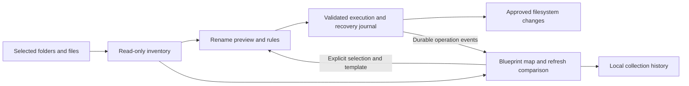

# Rename and Blueprint: design overview

Date: 2026-10-17

Status: written specifications for user review; implementation has not started.

## Agreed direction

Build a complete bulk-renaming feature for large video collections. Use the video-relevant capabilities of Bulk Rename Utility as the functional benchmark, implemented for VidLibOrganizer's existing Rust/Tauri application. Rename ships as a useful, independent feature without a flagship capability.

Blueprint is a separate, broader direction: a remembered map of a collection's structure, observed changes, naming templates, and eventually pattern analysis. Its first delivery is a working foundation and explicitly labelled proof of concept. It is not required to become a mature collection-management product before Rename can ship.

This incorporates the user's 2026-10-17 adjustment and approval to write specs. It replaces the earlier proposal to make Collection Blueprint a hero feature inside Rename. It does not change the behavior of the currently implemented duplicate finder.

## Specifications and ownership

| Specification | Delivery standard | Owns |
| --- | --- | --- |
| [Rename](2026-10-17-renaming-design.md) | Production feature | Rules, metadata-based naming, previews, safe execution, recovery, history, undo, presets, folder/destination workflows. |
| [Blueprint foundation](2026-10-17-blueprint-foundation-design.md) | Functional foundation with experimental surfaces | Collection identity, remembered structure, refresh comparisons, library changelog, template attachments, descriptive pattern analysis. |

The specs share an inventory contract and operation events. Blueprint can supply files and an explicitly selected template to Rename. Rename does not depend on a Blueprint database, a registered collection, or experimental pattern recognition.

## Assumptions used to make the design concrete

- Windows remains the supported desktop release platform. Rust domain logic and filesystem fixtures remain testable on Linux where the filesystem supports the operation.
- All delivered behavior is offline. Optional online identification is a future design decision; the earlier optional question about it was not answered.
- Blueprint records live in the app's local data directory. A small identity file inside a collection is an opt-in capability. The user has been offered a choice about storage; this default is a reviewable assumption, not an instruction to create markers during this planning task.
- Neither a familiar directory shape nor a matching collection name proves identity. A library can be recognized without understanding its movies or episode semantics.
- Changelogs describe observations between scans and completed app operations. They cannot reconstruct every event that happened while the app was closed.

## Delivery relationship

1. Establish the shared inventory and operation-coordination contracts while delivering Rename's safe preview/execution foundation.
2. Complete Rename's full feature matrix and Windows verification. Intermediate milestones are not described as the finished feature.
3. Deliver Blueprint registration, persistent snapshots, collection recognition, and change history using the same inventory.
4. Deliver Blueprint's basic template and pattern surfaces as the proof of concept. Template editing is functional; convention inference and collection-wide reconciliation remain future work.

Blueprint work may proceed alongside Rename after the shared contracts stabilize. Its experimental surfaces must not delay or weaken Rename's release criteria. No execution method or parallel-agent approach has been selected by the user.

## Review decisions

The product split and permission to write these specs are confirmed. Review the two written specs next, including the app-local/optional-marker assumption and the precise definition of Blueprint's first usable delivery. After written-spec approval, create separate implementation plans for Rename and Blueprint; keep shared work owned by the Rename foundation so it is implemented once.

The existing [first-release spec](../../spec.md) and [verification record](../../verification.md) describe the shipped duplicate-finder baseline, not completion of these proposals.
